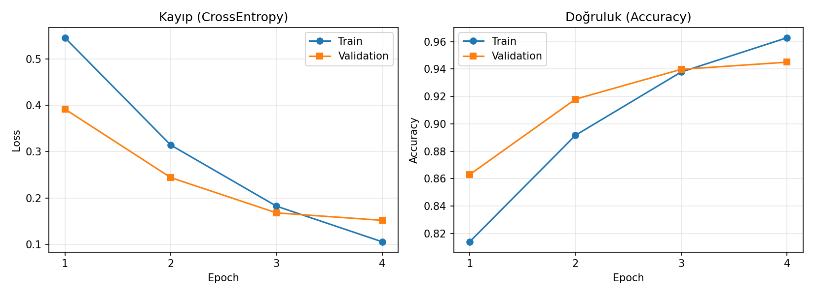
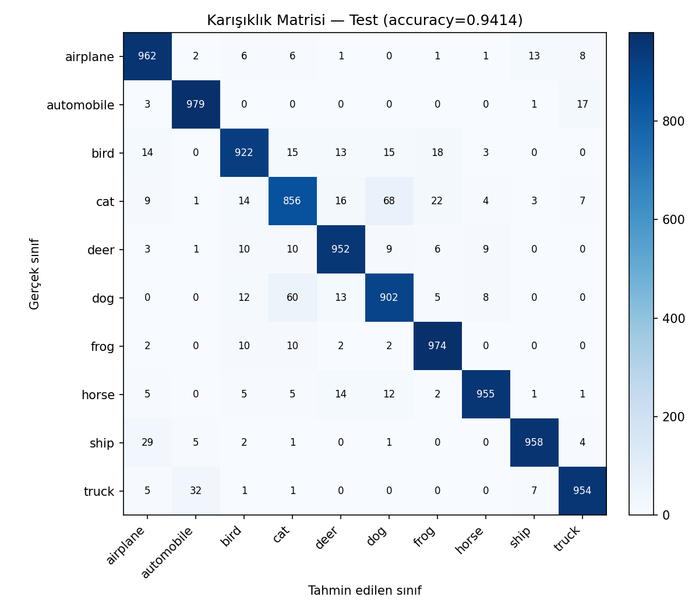
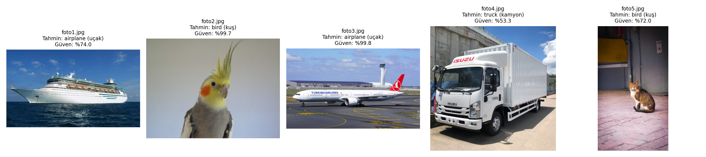
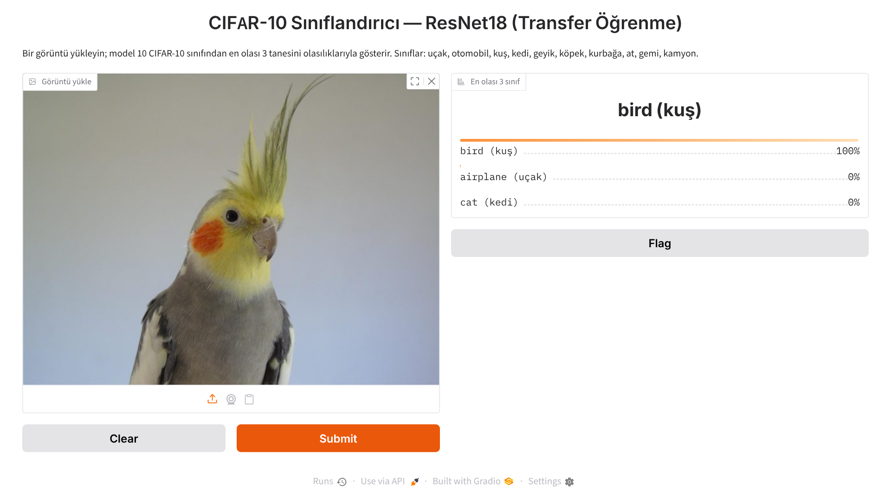

# CIFAR-10 Görüntü Sınıflandırma — ResNet18 ile Transfer Öğrenme

**BIL485 Derin Öğrenme — Ödev 2: Computer Vision**

Bu projede açık kaynak **CIFAR-10** veri seti (10 sınıf: uçak, otomobil, kuş, kedi, geyik, köpek, kurbağa, at, gemi, kamyon) üzerinde, **ImageNet'te ön-eğitilmiş ResNet18** modeli ince ayar (fine-tuning) ile eğitilmiştir. Model; Accuracy, Precision, Recall, F1, karışıklık matrisi, öğrenme eğrileri, eğitim ve çıkarım süresi ile değerlendirilmiş, 5 gerçek dünya fotoğrafıyla test edilmiş ve **Gradio** ile web arayüzü olarak sunulmuştur.

## Dosyalar

| Dosya | Açıklama |
|---|---|
| `BIL485_Odev2_CIFAR10_ResNet18.ipynb` | Tüm akış: veri, model, eğitim, değerlendirme, gerçek fotoğraf testi, Gradio, rapor özeti |
| `app.py` | `best_model.pth` dosyasını yükleyen bağımsız Gradio uygulaması |
| `requirements.txt` | Gerekli Python paketleri |
| `Rapor_Sablonu_Taslak.md` | Ödev raporu taslağı |

## Notebook'u çalıştırma (Google Colab)

1. Notebook'u Colab'da aç.
2. **Runtime > Change runtime type > T4 GPU** seç.
3. **Runtime > Run all**. (Toplam ~15–20 dk.)
4. Gerçek fotoğraf testi `gercek_fotograflar/` klasöründeki 5 fotoğrafı otomatik kullanır.
5. Gradio hücresindeki `…gradio.live` linkinden arayüzü dene.
6. Son hücre `sonuclar.zip` dosyasını indirir (grafikler, metrikler, `rapor_ozeti.txt`, `best_model.pth`).

## Gradio uygulamasını yerelde çalıştırma

```bash
pip install -r requirements.txt
# eğitilmiş model (best_model.pth) repoda hazırdır
python app.py            # http://127.0.0.1:7860
python app.py --share    # geçici public link
```

> Not: `best_model.pth` (~45 MB) Colab eğitiminde en yüksek doğrulama doğruluğuna ulaşan modeldir.

## Yöntem (özet)

- **Veri bölünmesi:** 50.000 eğitim görüntüsü sabit tohumla (seed=42) 45.000 train / 5.000 validation; resmi 10.000 test seti.
- **Ön işleme:** 32×32 → 128×128; train'de RandomResizedCrop(ölçek 0.7–1.0) + yatay çevirme; ImageNet normalizasyonu.
- **Model:** ResNet18 (ImageNet1K_V1), son katman 512→10, tüm katmanlar eğitilir.
- **Eğitim:** AdamW (lr=1e-3, weight decay=0.05), cosine LR planı, batch 128, 4 epoch, CrossEntropyLoss, karma hassasiyet (AMP).
- **Çıkış:** logitler üzerinde softmax → sınıf olasılıkları; arayüzde en olası 3 sınıf.

## Sonuçlar

Google Colab, Tesla T4 GPU üzerinde elde edilen sonuçlar (test seti: 10.000 görüntü):

| Metrik | Değer |
|---|---|
| Test Accuracy | **0.9414** |
| Precision (macro) | 0.9414 |
| Recall (macro) | 0.9414 |
| F1 (macro) | 0.9413 |
| En iyi Val Accuracy (epoch) | 0.9450 (4) |
| Eğitim süresi | 1.70 dk (4 epoch, ~25 s/epoch) |
| Çıkarım süresi (batch=1) | 3.13 ms/görüntü |
| Verim (batch=256) | 8928 görüntü/s |
| Gerçek fotoğraflar (top-1 / top-3) | 3/5 / 5/5 |

En zayıf sınıflar kedi (F1 0.872) ve köpek (F1 0.898); en çok karışan çiftler kedi↔köpek, kamyon↔otomobil ve gemi↔uçak. Gerçek fotoğraf testinde kuş, uçak ve kamyon doğru; gemi "uçak", kedi "kuş" olarak tahmin edildi (doğru sınıf her ikisinde de 2. sırada). Ayrıntılı değerlendirme rapordadır.






## Kaynak

- CIFAR-10: A. Krizhevsky, *Learning Multiple Layers of Features from Tiny Images*, 2009 — https://www.cs.toronto.edu/~kriz/cifar.html
- K. He vd., *Deep Residual Learning for Image Recognition*, CVPR 2016.
